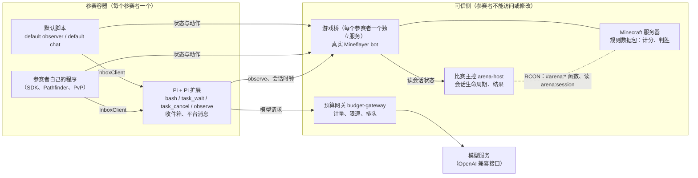

# Craft Arena：Minecraft AI 竞速测试场

Craft Arena 给一个通用 coding AI 一个 Minecraft 角色。每个参赛者拿到的公开能力和资料都相同，模型调用速率有限；它自己决定怎样观察、判断和写程序，比赛成绩用来比较这些做法的效果。首类场景是 Race of Wool 一类 PvP 竞速地图：两队收集指定羊毛并放到本队纪念碑上。玩法规则和胜负判定可以交给服务器上的数据包或插件，比赛主控只管会话；不比赛时，也可以让游戏桥单独运行一个 `open` 会话，让模型在普通服务器里陪玩（见 [docs/GAME-MODES.md](docs/GAME-MODES.md)）。

## 架构：可信侧与参赛容器



- 每个参赛者的游戏桥是独立服务，只接在后端网络和本队网络上；参赛容器访问不到别队的游戏桥和比赛主控。游戏桥从比赛主控读会话状态，也可以不要比赛主控、直接从服务器读（手动开局的小游戏、陪玩）。
- 只有游戏桥连接 Minecraft。它只接受经过校验的语义动作（移动、挖、放、攻击、交互等），不转发自定义数据包。比赛开始前和结束后，所有动作都被拒绝。
- 只有预算网关持有模型凭证。它只开放 `/chat/completions` 和 `/budget` 两个入口。
- Pathfinder、PvP 等 Mineflayer 插件在参赛者自己的程序里运行，基于本地镜像（`connectBot()` 在程序里保存的 bot 状态副本）计算，算出的动作再发给游戏桥。
- Pi 扩展从游戏桥的 `/v1/session` 读取会话状态和时钟：比赛由比赛主控提供，陪玩等 `open` 会话由独立运行的游戏桥自己提供。
- Minecraft 服务器只在内部网络，不对宿主机开放端口。

### 谁能改什么

| 部分    | 包含                                                                                                   | 参赛者能做什么                                                                                          |
| ------- | ------------------------------------------------------------------------------------------------------ | ------------------------------------------------------------------------------------------------------- |
| 可信侧  | 比赛主控、游戏桥、预算网关、Minecraft 服务器；游戏桥记录的区块记忆                                     | 不能访问或修改，只能通过游戏桥和预算网关的公开接口使用。运营者负责配置                                  |
| Pi 扩展 | `bash`、`task_wait`、`task_cancel`、`observe` 工具；任务管理；收件箱；平台消息；会话开始时启动默认脚本 | 在容器里运行，Pi 启动时加载，比赛中不能换掉。它决定信息何时送到模型                                     |
| 工具包  | `$ARENA_TOOLKIT_ROOT` 下的一切：SDK、观察库、默认脚本、截图与图像库、区块记忆查询客户端、示例和 Skill  | 可以读、运行、复制、改写或不用。默认观察器和聊天转发也只是普通任务，可以 `task_cancel` 后换成自己的版本 |

参赛 AI 目前是 Pi 1.1.0。游戏 SDK 和观察库不依赖 Pi；换别的 coding agent 时，替换的是 `packages/pi-extension`。

## 一场比赛怎么进行

1. **准备。** 运营者选定地图、规则和时限，配置队伍、模型价格和速率上限，启动服务器和可信侧服务。比赛主控重置地图，为每个参赛者连上一个游戏桥，此时动作仍被拒绝。
2. **开局。** 启动器在容器里启动 Pi，等比赛主控报告比赛开始，然后发出一次开局提示：[examples/PROMPT.md](examples/PROMPT.md)、比赛简报（队伍、地图、目标、时限等公开事实）。不附图像，模型需要时自己运行截图脚本。Pi 会话一开始，Pi 扩展就把默认观察器和默认聊天转发作为后台任务启动；第一个请求最多等观察器 5 秒，带上它的第一份状态报告。
3. **比赛。** 模型在普通的工具调用循环里工作：调用工具、写程序、启动任务。`bash` 和 `task_wait` 默认最多等 30 秒，等满时返回 `running` 和 `taskId`，程序继续运行。模型思考和排队时，游戏照常进行。Pi 在模型回答结束后也不退出（持续会话）。模型停下、比赛仍在进行、又没有非后台任务在运行时，5 秒后 Pi 扩展会提醒它继续（空闲提醒）。
4. **结束。** 服务器上的规则数据包判定胜负（羊毛竞速：每刻检查纪念碑方块），比赛主控通过 RCON 轮询 `arena:session`；服务器宣布结束或时间到，比赛结束。游戏桥停止接受动作，比赛主控保存结果（默认还有服务端录像）。启动器读到结束状态后关闭 Pi，Pi 扩展随之停止所有任务。

## 模型看到的信息：三条通道

模型只在发出请求时看到新信息。发出请求的时刻叫**请求边界**：开局提示、一批工具调用结束、一个回合结束，或一条消息开启新回合。

| 通道     | 来自                                                                  | 何时到达模型                                                         |
| -------- | --------------------------------------------------------------------- | -------------------------------------------------------------------- |
| 工具结果 | 模型自己调用的工具（`bash`、`task_wait`、`observe` 等）               | 工具返回本身就是一个请求边界                                         |
| 收件箱   | 参赛者的程序（包括默认观察器和聊天转发）；Pi 扩展的任务与程序状态报告 | 普通消息随下一个请求边界附带；紧急消息提前结束等待，或唤醒空闲的会话 |
| 平台消息 | 比赛主控（会话时钟）、预算网关（预算反馈）                            | 回合结束时排入，随下一个请求送达，自己不发起请求                     |

另有只在查询时才读的信息：`observe` 的完整状态、区块记忆、程序日志。详细规则见 [docs/CONTEXT-DELIVERY.md](docs/CONTEXT-DELIVERY.md)。

## 当前优先级

完整清单在 [docs/ROADMAP.md](docs/ROADMAP.md)，那里是唯一的待办列表。下一场比赛之前：

- 新开局时可选清空工作区里上一场的代码（先归档）。
- 在地图副本里人工确认大厅起点机关在 1.21 下能用。
- 比赛记录统计时间去向：模型思考、排队、工具等待、程序执行、无进展。
- 之后：容器内 Pi 自己 OAuth 登录时的计量（出网代理 + 账本服务）。

## 验证状态

| 内容                                                                                                    | 状态                                                                                                                                         |
| ------------------------------------------------------------------------------------------------------- | -------------------------------------------------------------------------------------------------------------------------------------------- |
| 完整自主对局（开局到判胜，全程无人干预）                                                                | **未验证**，还没有这样的记录                                                                                                                 |
| 默认观察器（改为默认脚本之后）                                                                          | 有单元测试（`tests/default-observer.test.mjs`）和真实 Pi 会话测试（`tests/runtime-state.test.mjs`）；**没有在真实 Minecraft 服务器上运行过** |
| 2026-10-11 实服观察检查（Minecraft 1.21.1，9 项）                                                       | 当时全部通过，但测的是之后已删除的会话内观察实现                                                                                             |
| 服务器协议 v1 与羊毛竞速数据包                                                                          | 2026-10-14 实服验证：比赛主控 + 两个真实 Mineflayer bot，bot 通过 SDK 放羊毛，数据包判胜；Direct Fire 地图本身没有装进去跑                   |
| Pi 接入与收件箱送达（普通、紧急、晚到结果只送一次、结束时退出）                                         | 真实 Pi 1.1.0 会话 + 固定模型响应，自动化测试通过                                                                                            |
| 可信侧：比赛主控、预算网关、游戏桥动作校验                                                              | 自动化测试；模拟比赛可离线复现                                                                                                               |
| 目标主机上的部署隔离（含 Windows 本机部署的当前版本）、真实 Chromium 截图、实战寻路与 PvP、模型读图效果 | 未验收                                                                                                                                       |

各项证据和验证等级见 [docs/VALIDATION.md](docs/VALIDATION.md)。

## 术语表

| 术语     | 含义                                                                                                                                                                                     |
| -------- | ---------------------------------------------------------------------------------------------------------------------------------------------------------------------------------------- |
| 可信侧   | 比赛主控、游戏桥、预算网关和 Minecraft 服务器；参赛者不能访问或修改                                                                                                                      |
| 比赛主控 | `packages/arena`：会话生命周期、通过 RCON 读服务器判定、结果（compose 服务 `arena-host`）                                                                                                |
| 游戏桥   | `packages/mf-bridge`：每个参赛者一个真实 Mineflayer bot，只执行校验过的语义动作                                                                                                          |
| 预算网关 | `packages/budget-gateway`：OpenAI 兼容的模型调用入口，计量每次调用，超出速率时排队                                                                                                       |
| 参赛者   | 一个参赛单位：一个容器、一个角色、一个模型会话、一个网关 key                                                                                                                             |
| Pi 扩展  | `packages/pi-extension`：加载进 Pi 的本项目代码，提供工具、收件箱、平台消息和默认脚本启动                                                                                                |
| 工具包   | `$ARENA_TOOLKIT_ROOT` 下参赛者可以读、运行、复制或不用的全部代码和资料                                                                                                                   |
| 默认脚本 | Pi 会话开始时由 Pi 扩展作为后台任务启动的普通脚本（`ARENA_DEFAULT_SCRIPTS` 选择）：`default observer`（报告状态变化、附近方块和告示牌、受伤死亡等事件）和 `default chat`（转发游戏聊天） |
| 任务     | 通过 `bash` 启动、用 `taskId` 跟踪的进程；用 `task_wait` 继续等、`task_cancel` 停止                                                                                                      |
| 等待时长 | 一次 `bash` / `task_wait` 调用最多阻塞多久（默认 30 秒，`wait_seconds` 可改）；到时返回 `running`，进程不停                                                                              |
| 请求边界 | 向模型发出请求的时刻；新信息只能在这时进入模型                                                                                                                                           |
| 收件箱   | Pi 扩展里的消息队列；程序用 `InboxClient` 发消息，随下一个请求边界送达并保留在历史中                                                                                                     |
| 紧急消息 | 优先级为 urgent 的收件箱消息：提前结束正在进行的等待（程序继续运行），或唤醒空闲会话                                                                                                     |
| 平台消息 | 回合结束时若有变化，发一条 `Arena platform message`，只含变化了的会话时钟和预算反馈；不属于收件箱                                                                                        |
| 区块记忆 | 游戏桥记录的角色收到过的区块，卸载后仍可查询；查到的是最后一次收到时的样子                                                                                                               |

## 文档索引

**参赛模型**（容器内路径前缀为 `$ARENA_TOOLKIT_ROOT`）

- [examples/PROMPT.md](examples/PROMPT.md)：开局提示
- [examples/SKILL.md](examples/SKILL.md)：怎样玩、第一步、示例程序
- [examples/FAQ.md](examples/FAQ.md)：常见的控制与时机错误
- [examples/BUDGET-AND-TEAM.md](examples/BUDGET-AND-TEAM.md)：预算反馈与队内 Git
- [packages/observation/README.md](packages/observation/README.md)：默认观察器报告什么、怎样改
- [packages/bot-sdk/README.md](packages/bot-sdk/README.md)：SDK 及与 Mineflayer 的差异
- [packages/bot-sdk/BLOCK-MEMORY.md](packages/bot-sdk/BLOCK-MEMORY.md)：查询区块记忆
- [packages/inbox/README.md](packages/inbox/README.md)：程序怎样给模型发消息
- [packages/world-visual/README.md](packages/world-visual/README.md)：按需截图

**运营者**

- [infra/README.md](infra/README.md)：Docker Compose 部署、比赛回放
- [infra/windows-local/README.md](infra/windows-local/README.md)：Windows 本机两队部署
- [infra/companion/README.md](infra/companion/README.md)：陪玩部署：独立游戏桥 + 一个参赛容器，接入普通服务器
- [infra/datapacks/race-of-wool/README.md](infra/datapacks/race-of-wool/README.md)：羊毛竞速规则数据包
- [infra/datapacks/arena-example/README.md](infra/datapacks/arena-example/README.md)：最小示例数据包，演示服务器协议 v1
- [packages/arena/README.md](packages/arena/README.md)：比赛配置与实服运行器
- [packages/budget-gateway/README.md](packages/budget-gateway/README.md)：价格、限速与预算配置
- [tools/replay-myopia/README.md](tools/replay-myopia/README.md)：赛后回放的近距视野滤镜（客户端工具）

**开发者**

- [AGENTS.md](AGENTS.md)：开发指南
- [docs/ROADMAP.md](docs/ROADMAP.md)：待办
- [docs/CONTEXT-DELIVERY.md](docs/CONTEXT-DELIVERY.md)：信息何时、从哪里送到模型
- [docs/GAME-MODES.md](docs/GAME-MODES.md)：玩法、会话类型与服务器协议
- [docs/VALIDATION.md](docs/VALIDATION.md)：验证状态与复现
- [packages/pi-extension/README.md](packages/pi-extension/README.md)：启动器、工具、持续会话
- [packages/tasks/README.md](packages/tasks/README.md)：任务管理
- [packages/mf-bridge/README.md](packages/mf-bridge/README.md)：游戏桥

**历史**：[docs/history/README.md](docs/history/README.md)（规格、比赛报告、验证日志、已退役实验）

## 代码地图

| 位置     | 包                                          | 作用                                               |
| -------- | ------------------------------------------- | -------------------------------------------------- |
| 可信侧   | `packages/arena`                            | 比赛主控、实服运行器、录像                         |
| 可信侧   | `packages/mf-bridge`                        | 游戏桥、区块记忆记录                               |
| 可信侧   | `packages/budget-gateway`                   | 模型调用计量与限速                                 |
| 参赛容器 | `packages/pi-extension`                     | Pi 扩展与启动器                                    |
| 参赛容器 | `packages/tasks`、`packages/inbox`          | 任务管理；收件箱与 `InboxClient`                   |
| 工具包   | `packages/bot-sdk`                          | `connectBot()`、插件适配、战斗报告、区块记忆客户端 |
| 工具包   | `packages/observation`                      | 观察库：单次采样、事件、变化报告、附近扫描         |
| 工具包   | `packages/default-scripts`                  | `observer.mjs`、`chat.mjs`                         |
| 工具包   | `packages/world-visual`、`examples/`        | 图像渲染；示例程序与截图脚本                       |
| 运营工具 | `infra/`、`scripts/`、`tools/replay-myopia` | 部署模板、运营脚本、回放客户端                     |

## 本地快速开始

需要 Node.js 24。全量自动化测试在 Linux 环境运行，依赖 `/bin/bash`、Unix socket 和 POSIX 信号；Windows 请在 Linux 容器或 WSL 中运行，并在该环境安装依赖。原生 Windows 的 `npm test` 不是完整验收入口。

```sh
npm ci
npm test                                                  # 全部自动化测试
node packages/arena/src/cli.mjs validate infra/match.example.json
npm run demo:match                                        # 模拟一场比赛（合成数据，不连 Minecraft）
npm run demo:screenshot                                   # 渲染离线夹具截图，需要本地 Chromium
```

测试里的模型响应来自本地假上游，不需要 API key。部署真实比赛见 [infra/README.md](infra/README.md)。
