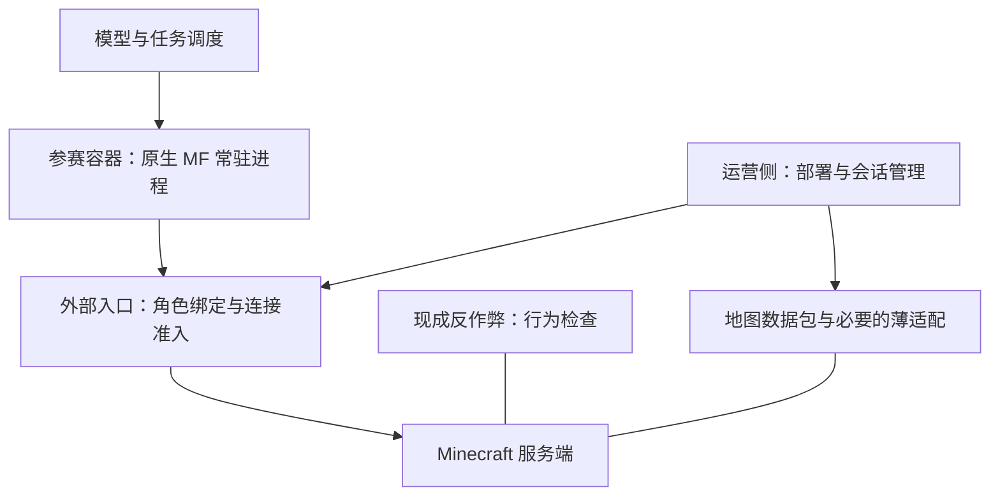

# Craft Arena 架构决策：原生客户端、外部身份入口与服务端行为检查

日期：2026-10-18（Asia/Shanghai）  
状态：目标方向已确定；服务端、反作弊版本与兼容配置待原型验证。本文不是已完成实施的说明。  
10-18 补充决定：默认用原版端，公平靠提示词约束（参赛者技术上能任意发包，但要求只用 Mineflayer 已有的能力）；反作弊端做好但默认不开，开启时只安静记录，报告赛后再看；具体选哪个反作弊不急着定。身份和登录管理套在服务端外面。实现见 [TARGET-ARCHITECTURE.md](TARGET-ARCHITECTURE.md) 第 5 节。  
范围：bot 运行位置、连接与角色管理、公平性检查、任务运行和服务端切换。地图包、模型接入和计分协议沿用现有方向，除非实施时发现冲突。

## 1. 决策摘要

采用“参赛容器内运行原生 Mineflayer，外部入口控制身份与连接准入，Minecraft 服务端检查行为”的方向。停止把完整远程 Mineflayer 镜像作为长期目标；在新方案验证通过前保留现有桥用于回退。

优先验证尽量接近原版玩法的 Fabric 加现成反作弊；Paper 加反作弊作为候选。严格 Vanilla 配置用于原版行为验证和可信实验，不自动视为具备相同防护的正式比赛配置。服务端实现按地图和比赛选择，不绑定到 arena 核心。

Grim 是优先验证的可修改候选，Matrix 是对照候选；二者不同时启用重叠拦截。没有任何候选已被本项目实测证明与当前 Mineflayer、1.21.1 地图及允许的特殊放置兼容。

## 2. 需求依据

平台希望评测模型理解环境、规划、编程和完成游戏任务的能力，而不是让协议漏洞、角色冒用或不可能移动主导比赛。允许程序比有头客户端更强：自动寻路、快速反应、自动操作，以及利用服务器已发送的区块与实体信息。部分原生 Mineflayer 可实现、但普通有头操作不方便或不能完成的放置，也可以被规则允许。

原来的“不让容器任意发包”是实现公平边界的手段。新方案将边界改为“客户端不可信，服务器限制行为效果”。这不是同等安全保证的透明替换：客户端可以自行构造包，检查可能存在漏检；原生 Mineflayer 版本也不再构成能力上限。

正式迁移必须接受这一取舍。如果后续重新要求所有操作都必须由可信 Mineflayer 方法产生，则应回到可信执行边界，而不能声称代理或反作弊能够证明包的来源。

| 需求维度 | 目标                                                                           |
| -------- | ------------------------------------------------------------------------------ |
| 感知     | 可分析、记忆和可视化服务器实际发来的信息；不提供服务器全知状态                 |
| 自动化   | 允许自编策略、插件、自动瞄准与重复操作；资源消耗和有效动作频率仍可受规则约束   |
| 物理     | 禁止飞行、穿墙、异常加速等不符合所选游戏规则的移动；兼容合法传送、药水、载具等 |
| 交互     | 放置、挖掘速度、攻击距离分别定义，不使用单一“宽松模式”替代规则                 |
| 身份     | 仅能登录分配角色；不能冒用角色、增加名额或访问管理接口                         |
| 原版特色 | 保留按场更换服务端配置的能力，不承诺运行存档可无损来回转换                     |

## 3. 为什么调整现有架构

当前桥把真实 Mineflayer 留在可信侧，并向容器复制状态和事件。容器侧 Pathfinder 等插件依赖同步本地读取，因此 SDK 不只承担传输，还实现原生行为、对象身份和事件时序。

已见维护成本包括：两端字段选择、实体与窗口恢复、动作结果与镜像修订排序，以及配方筛选、光标查询、爆炸伤害和聊天匹配等本地实现。PR #20 一次补齐 51 个方法，部分是包装，部分包含行为重写；PR #2 曾因 controlState 的不可枚举 getter 丢失而破坏 Pathfinder 预测。此处没有对全仓重复代码比例作统计。[1][2][3]

字段协议与通用 RPC 可以减少机械重复，但不能消除同步查询、对象引用、回调和事件顺序的兼容成本。让真实 Mineflayer 回到容器，能够直接复用上游，而将公平性维护集中在规则和现成服务端检查上。

## 4. 目标结构与信任边界



参赛容器及其所有程序均不可信，包括 Mineflayer、插件和本地包装器。代理、服务器、反作弊和运营配置属于可信侧。容器只可访问被授权的入口；后端游戏端口、RCON、代理管理接口和其他队伍私有服务不可直达。

规则部署在可信侧，不依赖容器内环境变量、不可修改的 SDK 或隐藏 _client 来强制执行。容器内可以保留便捷 API，但它不是安全边界。

### 4.1 原生 bot 运行时

每个角色在参赛容器内由一个常驻原生 Mineflayer 实例控制。world、entities、inventory、registry 和物理状态均由上游原生实现维护。原生插件与需要同步 bot API 的代码在该进程内加载，无远程镜像更新延迟。

模型可以加载自定义模块，因为该进程没有可信权限。加载入口需方便启动、取消和记录任务，但无需为安全而限制成预装插件清单。

多个独立脚本不能各自 createBot 登录同一个角色。需要完整同步接口的任务运行在常驻进程内；独立进程通过本地任务接口提交操作或获取结果，不承诺同步原生 bot 透明跨进程。观察器也应作为常驻进程内模块或显式的订阅客户端运行。

任务运行需要规定事件监听器与定时器清理、取消导航、释放控制键和同一插件实例的并发调用语义。第一版不构建通用资源仲裁系统，但至少明确两个导航任务是拒绝、替换还是要求先取消。不同角色可以用独立进程隔离故障。

任意模块可阻塞或终止本角色进程，这是该方案的可用性取舍。外部监督可检测无响应和进程退出；重启按掉线规则处理，不假装无损恢复插件内部状态。

### 4.2 身份入口与协议连接

优先使用现成代理及扩展点，按可信容器身份或隔离的角色入口映射到允许的角色。不能仅相信客户端用户名，也不能让不同参赛者共享可冒用的角色凭据。

第一版优先“请求身份匹配则准入，不匹配则拒绝”。只有确实需要隐藏真实账号、代登录或替换身份时，才实施身份改写。代理自己选择上游地址并建立上游连接；修改握手里的地址字段不能代替网络隔离。

两段连接分别处理握手、登录、协议阶段、压缩，以及适用时的认证与加密。若改写身份，下行登录结果也必须一致；账号认证、UUID 和签名相关语义须按目标版本验证，不视为通用字符串替换。比赛自建服务器与外部正版服务器的接入方式分开处理。

入口负责：角色归属、并发连接名额、目标服务器、准入时机、重连策略和撤销连接资格。服务端只信受保护的代理转发信息。代理不维护第二份 bot 世界，也不在正常游戏流量中重写移动和背包逻辑。

容器仍可主动断开。第一版不实现“MF 退出但角色完整保持在线，随后新 MF 无缝接管”；若未来确需此能力，作为独立协议恢复项目评估。

### 4.3 服务端与比赛规则

计分、准备、开始、结束和公开会话信息继续优先使用数据包与现有 RCON 协议。需要身份或动作冻结等数据包无法可靠实现的能力时，使用薄的服务端适配，不把地图逻辑移入特定插件 API。

停赛由服务端明确冻结或按规则断开，不能在代理任意丢弃全部游戏包，以免破坏协议状态。客户端对开赛的等待只提供体验，不能构成强制限制。

服务器胜负与成绩是权威结果；客户端观察报告用于解释过程，不作为未验证的计分依据。

## 5. 行为检查策略

| 行为                             | 目标策略           | 实施注意                                                     |
| -------------------------------- | ------------------ | ------------------------------------------------------------ |
| 自动寻路、自动战斗、快速转头     | 允许               | 不以人类反应、鼠标轨迹或机器人特征判违规                     |
| 已接收区块与实体的透视、历史记忆 | 允许               | 保持各角色相同的发送范围与信息策略，不额外赋予全图读取       |
| 飞行、穿墙、异常加速与时间加速   | 禁止               | 检查必须纠正或拒绝效果，不能只有事后日志                     |
| 击退、跌落与正常运动限制         | 原则上遵守游戏机制 | 覆盖服务器传送、重生、载具与合法效果，避免误判               |
| 特殊放置                         | 按明确场景允许     | 分清视线、转向、距离、频率与材料消耗，不整体关闭所有交互保护 |
| 攻击距离与挖掘速度               | 待规则具体化       | 允许自动化不意味着无限距离或瞬间破坏                         |
| 畸形包、刷包、崩溃攻击、越权命令 | 限制               | 反作弊不是完整协议安全与资源隔离方案                         |

禁用或适配可能污染机器人观察的检测诱饵，例如假实体；不用全局绕过权限放行整只 bot。保留基础世界、事务与时序跟踪，仅调整需要放开的判定和处置。

检查配置须区分检测、告警、取消数据包、位置回退与踢出。移除惩罚命令不等于取消干预。固定版本后按源码、配置与效果验证实际行为。

初期可在隔离实验中仅记录以定位误判；正式比赛必须明确哪些检查主动阻止、哪些仅记录、违规结果如何处理。对快速达成目标的违规，不能只依赖延迟踢人。

## 6. 服务端与检查选型

底座和检查是两个独立维度。保留接近原版玩法，不要求自研反作弊。

| 候选                                  | 用途与优势                                                 | 尚待验证                                     |
| ------------------------------------- | ---------------------------------------------------------- | -------------------------------------------- |
| Fabric + Grim                         | 优先原型；尽量保持原版地图行为，并复用可检查源码的运动引擎 | 对应 1.21.1 构建、依赖、检查开关和 MF 兼容   |
| Paper + Grim                          | 在 Paper 生态中验证同类检查                                | 地图红石、区块及原版特色差异                 |
| Paper + Matrix                        | 检查与子检查配置粒度明确，作为对照                         | 目标版本、许可、实际干预粒度、MF 误判        |
| Vulcan / Updated-NoCheatPlus / Intave | 若首批候选不合适再评估                                     | 版本支持、可配置性、源码或修改条件、维护成本 |
| Vanilla                               | 原版行为基线、可信实验或接受不同防护的场次                 | 不自动具备与正式配置等价的防护               |

没有选定最终产品，也没有确认存在开箱即用的“MF 竞技模式”。不要同时堆叠多个重叠移动反作弊来替代规则设计。源码是否公开、允许何种修改和发布，分别按候选许可证确认。

## 7. 按地图和比赛切换服务端

将服务端类型、Minecraft 版本、扩展版本、配置文件及校验值打包成版本化的 server profile。地图声明所需机制和已验证 profile；比赛选择明确的 profile。客户端、代理和后端优先使用相同协议版本，第一版不引入跨版本转换。

以下是拟议配置形状，不表示现有 cli 已支持：

```json
{
  "serverProfile": "fabric-mc1.21.1-arena-v1",
  "rulesProfile": "automation-allowed-v1",
  "map": "direct-fire"
}
```

profile 至少记录服务器构建、反作弊与依赖版本、检查配置、身份转发方式、视距、实体跟踪范围及必要的玩法配置。记录客户端默认 MF/插件版本以便复现，但不把可修改的客户端版本当强制能力边界。

每场从不可变的原始地图副本启动，运行存档按 profile 隔离。切换端发生在新场次，不支持进行中的热切换，也不承诺同一运行存档双向无损迁移。

临时需要原版特色时：先验证当前底座是否可配置恢复；不能恢复则为该地图选另一 profile，从原始副本开局。换端后的成绩只能在相同规则与 profile 下直接比较，或明确标记差异。

保留机关验证场景：活塞与红石、出生与重生、区块加载、实体行为、数据包计分。通用平台接口保持稳定，后端适配可以不同；若切至严格 Vanilla 无法提供某项能力，明确缺失，不偷偷降低正式比赛保证。

## 8. 迁移顺序与验收门槛

### 阶段一：规则与兼容原型

先固定当前 MC、MF 和地图版本，写出允许与禁止的动作场景。用 Fabric + Grim 验证；必要时用 Paper + Matrix 对照。此阶段不删除现有桥，不扩大成支持所有服务端的框架。

正常场景覆盖移动、跳跃、游泳、击退、梯子、传送、重生、导航、自动战斗、认可的特殊放置、容器转移和合成。违规场景在隔离测试服验证飞行、穿墙、超速、时间加速等实际效果被拒绝或纠正。保存服务器轨迹、检查日志和结果，不能只看客户端输出。

另测高延迟、抖动与任务计算造成的事件循环停顿，确认既不过度误伤，也不因超时豁免形成明显漏洞。每个例外需说明放开了什么，不能靠全局关闭运动检查让正常场景通过。

### 阶段二：身份入口

验证跨角色登录被拒绝、重复连接受控、后端直连不可达、准入撤销生效、重连不绕过比赛状态，以及客户端无法伪造受信转发身份。先使用一个固定协议版本和自建服务器部署。

### 阶段三：容器内常驻运行时

把 observer、chat、Pathfinder 与需要原生 bot 的任务迁至同一角色运行时。验证多任务启动、取消、控制释放、插件状态清理、进程崩溃与重连策略。重新确认原有 bash 任务和收件箱体验，不假定旧 connectBot 用法无改动兼容。

### 阶段四：真实地图对局与切换

从地图副本跑完整对局，验证开始、停止、胜负、死亡重生和重要机关。性能指标至少记录 bot 事件循环停顿、代理延迟、服务器 tick 状态及反作弊回退次数。阈值从基线测量制定，不预先编造。

验证成功后新部署默认使用新路径，旧桥作为限期回退保留。待明确的验收周期通过，再删除状态镜像、重复原生方法实现和不再使用的协议；相应更新架构文档、SDK 说明、示例和测试。

## 9. 失败条件与回退

若正常 MF 运动必须大幅放松核心运动检查才能通过，或特殊放置例外必须破坏通用协议跟踪，则重新评估候选。若需要长期维护大范围反作弊分叉，不能继续以“少量补丁”估算成本。

若仍有关键违规能稳定改变比赛结果，且无法通过合理配置修复，则新方案未达到正式比赛门槛。回退到旧桥是部署选择；不表示旧桥已经解决所有公平性问题。两条路线分别保留自己的能力边界说明。

## 10. 未决事项

1. 所选 MC 版本上 Fabric、Grim 与依赖的精确构建及可用性。
2. 哪些特殊放置被允许；攻击距离、挖掘速度与有效操作频率的明确规则。
3. 角色绑定采用隔离入口、代理插件身份认证还是其他可信映射；是否真的需要代理改写身份。
4. 掉线后的角色、比赛结果与重连政策；不默认增加无缝接管。
5. 常驻 bot 模块接口、任务并发策略及取消语义。
6. 哪些原版机关和机制属于地图必须通过的回归集。
7. 正式检查的处置、证据保存、误判处理与配置版本升级规则。

## 11. 参考资料与证据边界

仓库依据来自本次讨论中读取的 main（083ce31e）及未合并 PR #23。公开资料核对日期为 2026-10-18；在线文档可能随版本变化，实施时固定具体 tag、构建及配置。以下资料证明功能或接口存在，不证明本项目兼容性已经通过。

1. [当前 bot SDK](https://github.com/ueagohbbcd/craft-arena/blob/083ce31e38b1178e0640b587cc240d8e79fe6afe/packages/bot-sdk/index.mjs)、[本地读取实现](https://github.com/ueagohbbcd/craft-arena/blob/083ce31e38b1178e0640b587cc240d8e79fe6afe/packages/bot-sdk/local-reads.mjs)。
2. [PR #20：补齐 Mineflayer 方法](https://github.com/ueagohbbcd/craft-arena/pull/20)。
3. [PR #2：controlState 序列化修复](https://github.com/ueagohbbcd/craft-arena/pull/2)。
4. [PR #23：此前目标架构草案](https://github.com/ueagohbbcd/craft-arena/pull/23)。本文调整其中可信桥与 SDK 的方向，不自动替换地图包等其他设计。
5. [Grim 项目与支持环境](https://github.com/GrimAnticheat/Grim)、[检查配置说明](https://github.com/GrimAnticheat/Grim/wiki/Punishments)。开源与多环境支持是候选依据；具体版本仍需验证。
6. [Matrix 检查配置](https://matrix.rip/docs/configuration/checks)：支持检查及子检查开关、阈值和处置配置。
7. [Vulcan 官方安装与配置入口](https://vulcanac.net/wiki/usage/first/)、[Updated-NoCheatPlus](https://github.com/Updated-NoCheatPlus/NoCheatPlus)、[Intave](https://github.com/intave/intave)：扩展候选，不代表均满足当前版本或修改要求。
8. [Velocity 后端保护](https://docs.papermc.io/velocity/security/)：现成代理及受保护转发基础，不等于已有 arena 角色绑定功能。
9. [Prismarine 协议代理示例](https://github.com/PrismarineJS/node-minecraft-protocol/tree/master/examples/proxy)：定制协议代理的实现参考，不是现成生产身份网关。
10. [Paper 与原版行为差异](https://docs.papermc.io/paper/vanilla/)、[Paper Anti-Xray](https://docs.papermc.io/paper/anti-xray/)：底座和信息混淆需要分别配置与验证。
